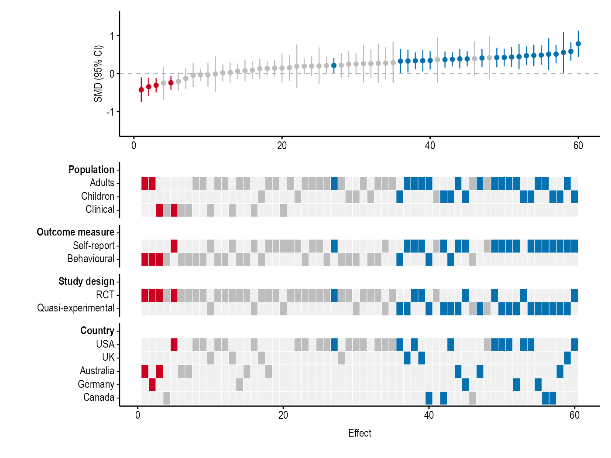

<!-- README.md is generated from README.Rmd. Please edit that file -->

# forestmap

<!-- badges: start -->

[](https://github.com/shaheedazaad/forestmap/actions/workflows/R-CMD-check.yaml)
[](https://shaheedazaad.r-universe.dev/forestmap)
<!-- badges: end -->

forestmap draws a **forest plot with a heatmap of study properties**.
Each study in your meta-analysis is shown with its effect size and 95%
confidence interval, sorted from smallest to largest. Underneath, a
heatmap shows each study’s properties (population, design, country, …),
so you can see at a glance whether studies with particular properties
tend to find larger or smaller effects.

## Installation

Install from [r-universe](https://shaheedazaad.r-universe.dev):

``` r
install.packages(
  "forestmap",
  repos = c("https://shaheedazaad.r-universe.dev", "https://cloud.r-project.org")
)
```

## Example

You need a data frame with one row per study: its effect size, the lower
and upper bounds of its 95% confidence interval, and one factor column
per study property. `NA` means the study doesn’t report that property.

``` r
library(forestmap)
head(forestmap_example)
#>         study   smd ci_lower ci_upper   n population     outcome
#> 1   Wang 2005 0.470    0.223    0.716 253   Children        <NA>
#> 2 Hughes 2013 0.261   -0.117    0.638 108   Children Behavioural
#> 3  Rossi 2005 0.510    0.092    0.928  88     Adults Self-report
#> 4  Baker 2006 0.410    0.170    0.649 268     Adults        <NA>
#> 5 Hughes 2008 0.786    0.442    1.130 130   Children Self-report
#> 6 Martin 2023 0.260   -0.234    0.754  63     Adults        <NA>
#>               design   country
#> 1                RCT       USA
#> 2                RCT      <NA>
#> 3 Quasi-experimental    Canada
#> 4 Quasi-experimental Australia
#> 5                RCT       USA
#> 6                RCT       USA
```

Tell `plot_forestmap()` which columns are which. Name the properties to
set the headings shown in the plot.

``` r
plot_forestmap(
  forestmap_example,
  es = "smd",
  lb = "ci_lower",
  ub = "ci_upper",
  moderators = c(
    "Population" = "population",
    "Outcome measure" = "outcome",
    "Study design" = "design",
    "Country" = "country"
  ),
  y_label = "SMD (95% CI)"
)
```



Blue studies have a confidence interval entirely above zero, red ones
entirely below, and grey ones include zero. In this example, every study
with a negative effect is an RCT, while the largest positive effects
come mostly from quasi-experimental studies using self-report measures.

You can change the font, colours, text size, layout and more: see
[Customising the
plot](https://shaheedazaad.github.io/forestmap/articles/customising.html).
Saving is up to you, e.g.:

``` r
p <- plot_forestmap(...)
ggplot2::ggsave("forestmap.png", p, width = 7, height = 5.25, dpi = 300)
```
