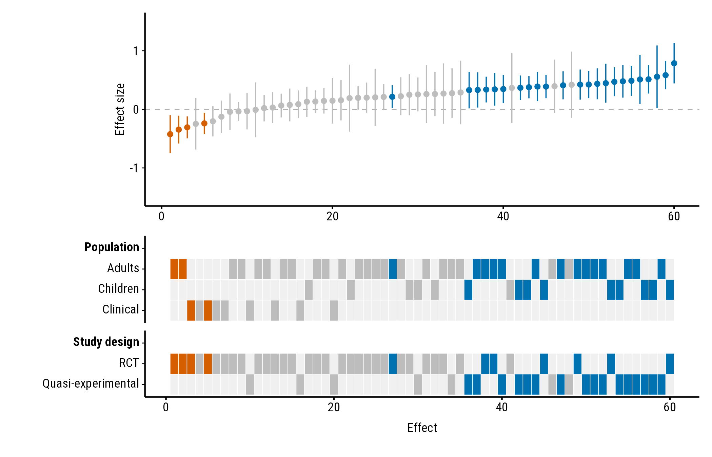
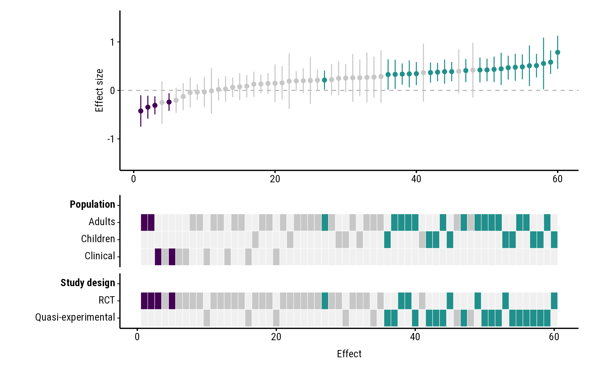
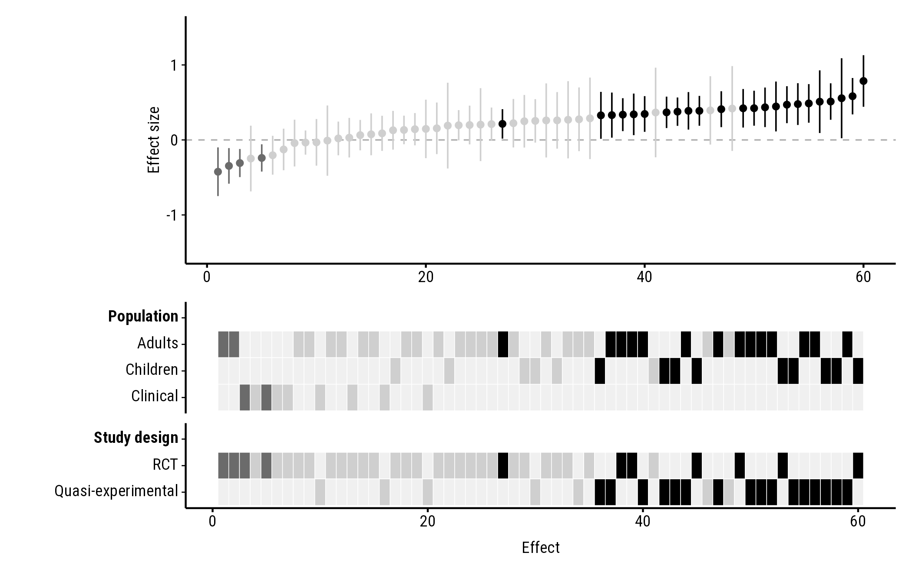
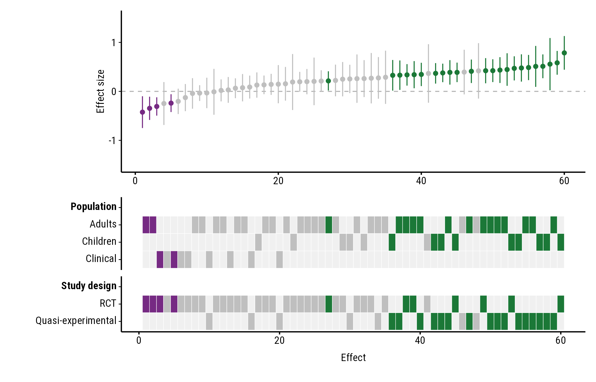
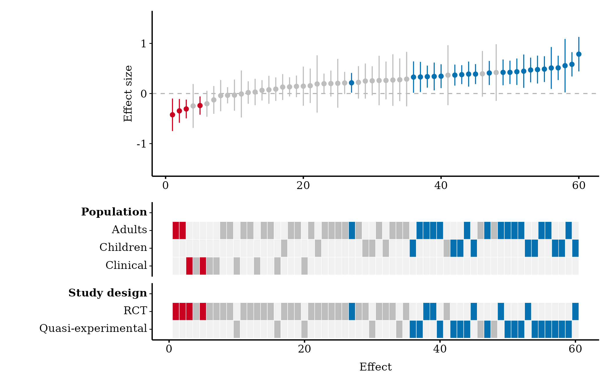
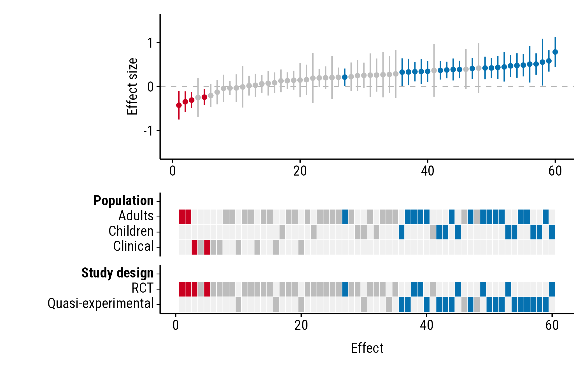
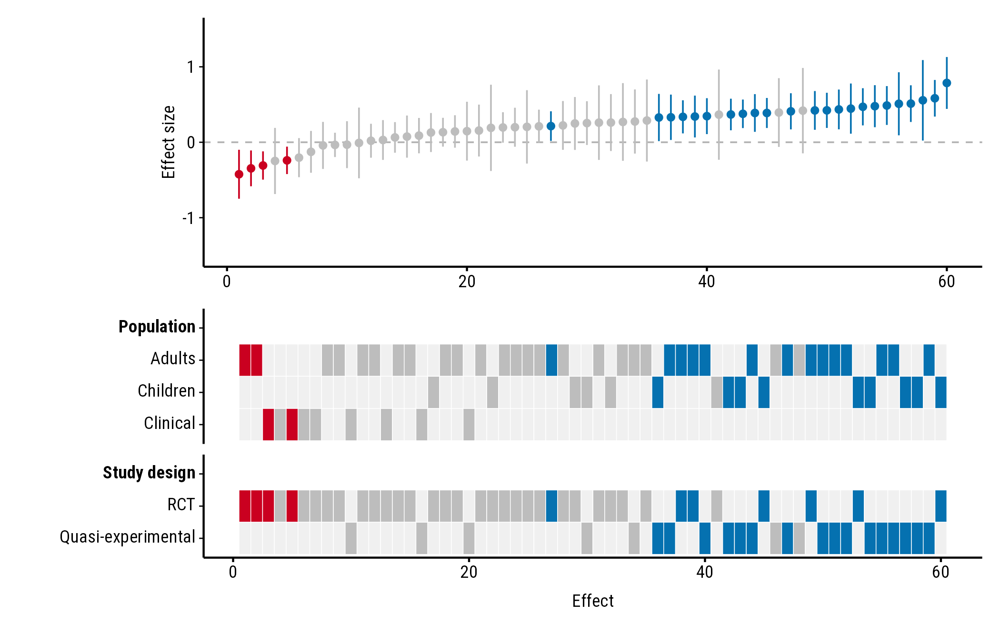

# Colours, fonts and size

``` r

library(forestmap)
```

How to change the colours, font, text size and the height of each panel.
All the examples use the `forestmap_example` data that comes with the
package.

## Colours

### Built-in palettes

Choose a palette by name. The options are `"default"` (blue, red and
grey, used everywhere else in these guides), `"okabe_ito"`, `"viridis"`
and `"greyscale"`.

`"okabe_ito"` uses blue and vermillion from the Okabe–Ito palette,
designed to stay distinguishable for people with common types of colour
blindness:

``` r

plot_forestmap(
  forestmap_example, "smd", vi = "vi",
  moderators = c("Population" = "population", "Study design" = "design"),
  palette = "okabe_ito"
)
```



`"viridis"`:

``` r

plot_forestmap(
  forestmap_example, "smd", vi = "vi",
  moderators = c("Population" = "population", "Study design" = "design"),
  palette = "viridis"
)
```



`"greyscale"`, for black-and-white printing:

``` r

plot_forestmap(
  forestmap_example, "smd", vi = "vi",
  moderators = c("Population" = "population", "Study design" = "design"),
  palette = "greyscale"
)
```



### Your own colours

Give three colours: for positive effects, negative effects, and effects
whose interval includes the null value. Any colour name or hex code
works:

``` r

plot_forestmap(
  forestmap_example, "smd", vi = "vi",
  moderators = c("Population" = "population", "Study design" = "design"),
  palette = c(positive = "#1b7837", negative = "#762a83", null = "grey75")
)
```



## Font and text size

### Font

`font` takes the name of any font installed on your computer. The
default, `"Roboto Condensed"`, comes with forestmap, so it works
everywhere; so do the generic names `"sans"`, `"serif"` and `"mono"`:

``` r

plot_forestmap(
  forestmap_example, "smd", vi = "vi",
  moderators = c("Population" = "population", "Study design" = "design"),
  font = "serif"
)
```



To see which fonts you have, run `systemfonts::system_fonts()$family`.
You can also use a font file that isn’t installed, by giving its path:

``` r

plot_forestmap(
  forestmap_example, "smd", vi = "vi",
  moderators = c("Population" = "population", "Study design" = "design"),
  font = "fonts/MyFont-Regular.ttf"
)
```

### Text size

`text_size` sets the size of all text, in points (default 9):

``` r

plot_forestmap(
  forestmap_example, "smd", vi = "vi",
  moderators = c("Population" = "population", "Study design" = "design"),
  text_size = 12
)
```



## Panel heights

By default, the heatmap gets more of the plot’s height the more rows it
has. `forest_height` sets the forest plot’s share of the height
yourself, between 0 and 1. Here the forest plot and heatmap get half
each:

``` r

plot_forestmap(
  forestmap_example, "smd", vi = "vi",
  moderators = c("Population" = "population", "Study design" = "design"),
  forest_height = 0.5
)
```


