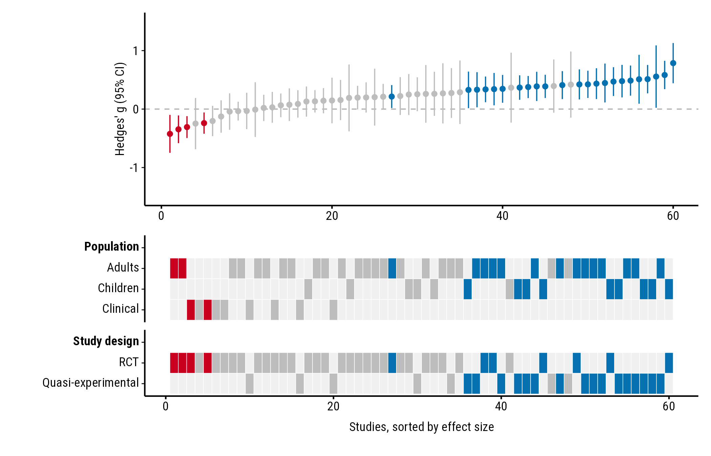
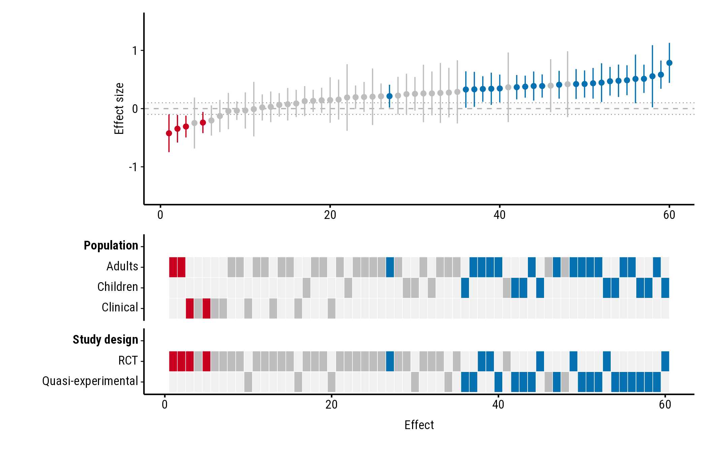
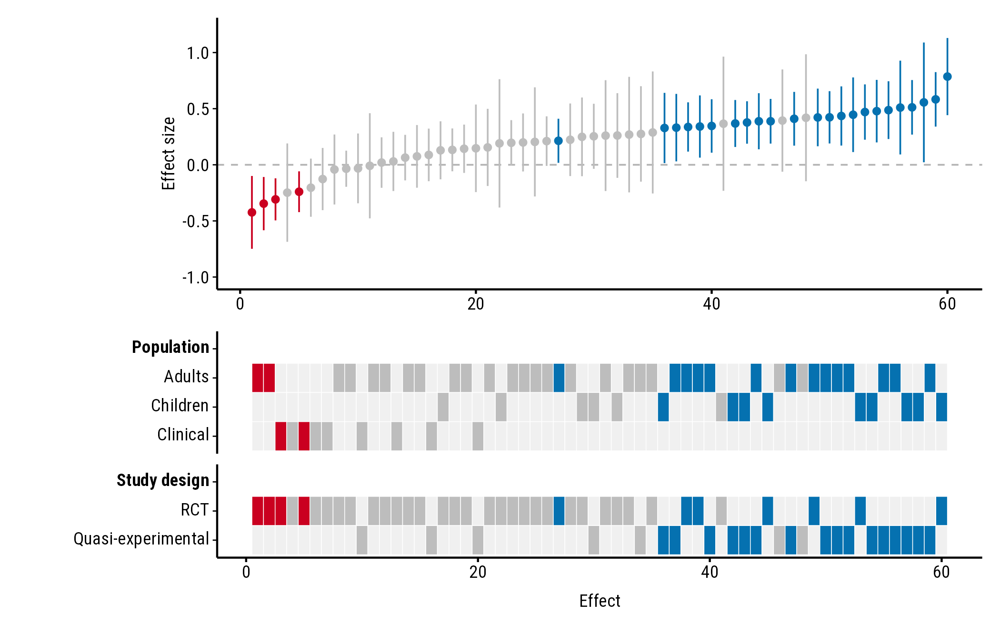

# Effect sizes and axes

``` r

library(forestmap)
```

How to set the axis titles, the value meaning “no effect”, a band of
effects too small to matter, and the axis range. All the examples use
the `forestmap_example` data that comes with the package.

## Axis titles

``` r

plot_forestmap(
  forestmap_example, "smd", vi = "vi",
  moderators = c("Population" = "population", "Study design" = "design"),
  y_label = "Hedges' g (95% CI)",
  x_label = "Studies, sorted by effect size"
)
```



## Ratios: `null_value`

Colours depend on whether each confidence interval excludes the value
meaning “no effect”. That’s 0 for differences (and log ratios) and 1 for
ratios such as odds ratios. Odds-ratio intervals aren’t symmetric, so
give the bounds with `lb` and `ub` rather than a variance. Here the
example effects are converted to odds ratios:

``` r

odds <- forestmap_example
to_log_or <- pi / sqrt(3)
odds$or <- exp(odds$smd * to_log_or)
odds$or_lower <- exp((odds$smd - 1.96 * sqrt(odds$vi)) * to_log_or)
odds$or_upper <- exp((odds$smd + 1.96 * sqrt(odds$vi)) * to_log_or)

plot_forestmap(
  odds, "or", "or_lower", "or_upper",
  moderators = c("Population" = "population", "Study design" = "design"),
  null_value = 1,
  y_label = "Odds ratio (95% CI)"
)
```


Ratios are often easier to read on the log scale: plot `log(or)` with
its variance (`vi`) and the default `null_value = 0`.

## Effects too small to matter: `rope`

`rope` shades a band of effects you consider too small to matter (a
“region of practical equivalence”). Give two numbers, or one number for
a band symmetric around `null_value`:

``` r

plot_forestmap(
  forestmap_example, "smd", vi = "vi",
  moderators = c("Population" = "population", "Study design" = "design"),
  rope = c(-0.1, 0.1)
)
```



## Axis range: `y_limits`

By default the y-axis is symmetric around `null_value` and wide enough
to show every confidence interval (for ratios, it starts at 0). Set your
own range with `y_limits`; parts of intervals outside it are cut off:

``` r

plot_forestmap(
  forestmap_example, "smd", vi = "vi",
  moderators = c("Population" = "population", "Study design" = "design"),
  y_limits = c(-1, 1.2)
)
```


