# Customising the plot

``` r

library(forestmap)
```

This page shows every way you can change a forestmap plot, with an
example of each. All the examples use the `forestmap_example` data that
comes with the package. Most use two study properties to keep the plots
small, but everything works the same with more.

## Headings and order

### Headings

Name each property to set its heading. Without a name, the column name
is used:

``` r

plot_forestmap(
  forestmap_example, "smd", vi = "vi",
  moderators = c("Who took part" = "population", "design")
)
```

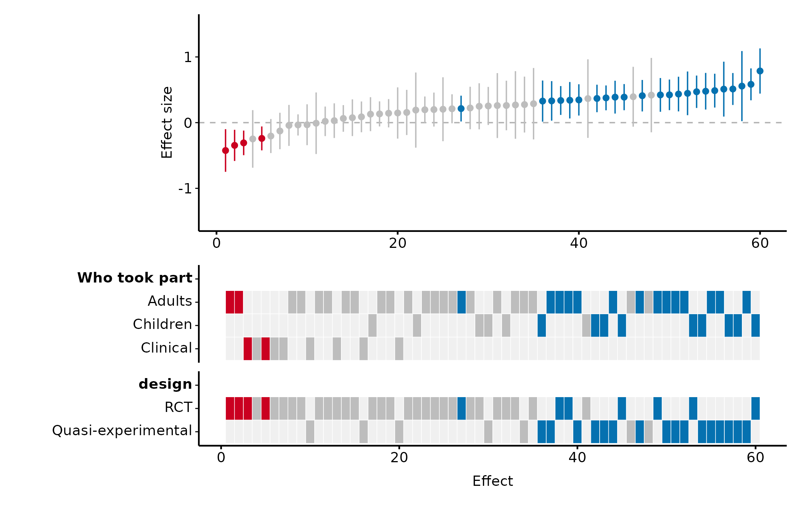

### Which properties, in which order

The heatmap shows the properties you list, in the order you list them:

``` r

plot_forestmap(
  forestmap_example, "smd", vi = "vi",
  moderators = c("Country" = "country", "Population" = "population")
)
```

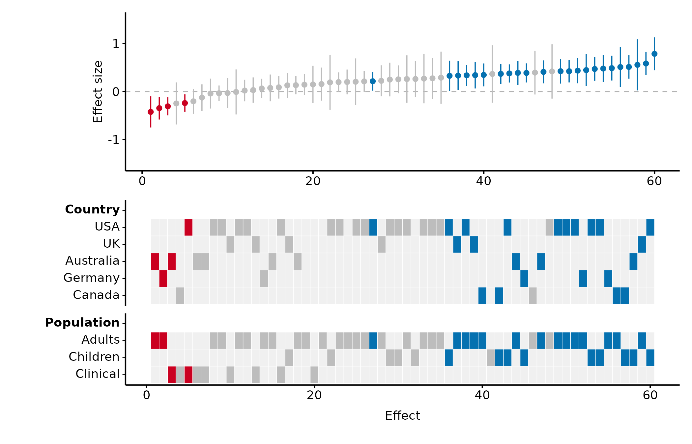

### Order and names of the rows

Rows follow the order of the factor’s levels. Change the order with
`factor(..., levels = ...)`, and rename levels with `labels = ...`:

``` r

dat <- forestmap_example
dat$population <- factor(
  dat$population,
  levels = c("Clinical", "Children", "Adults"),
  labels = c("Clinical samples", "Children (< 18)", "Adults (18+)")
)

plot_forestmap(
  dat, "smd", vi = "vi",
  moderators = c("Population" = "population", "Study design" = "design")
)
```

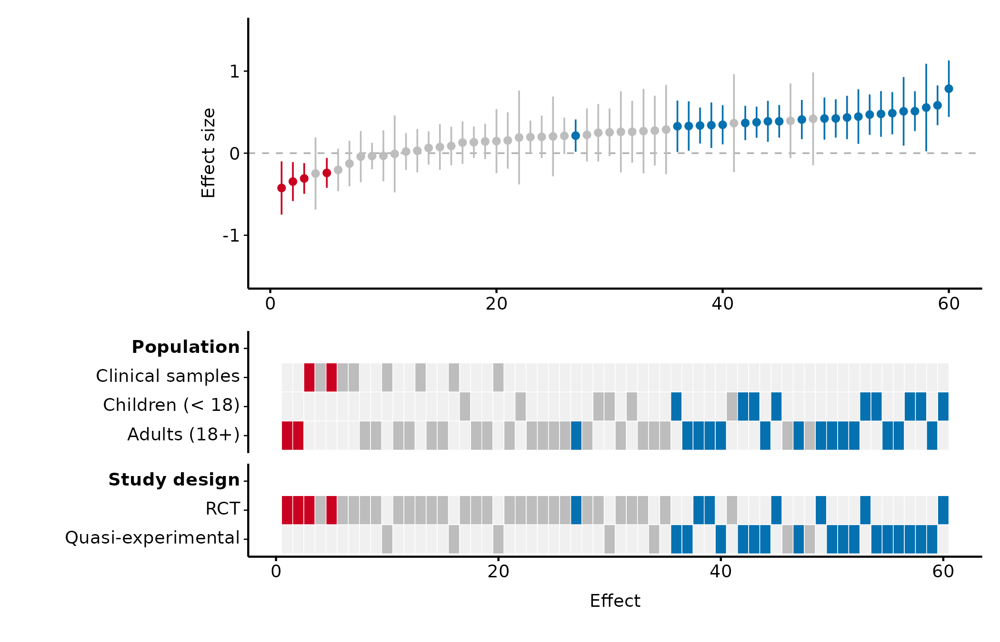

## Axis titles

``` r

plot_forestmap(
  forestmap_example, "smd", vi = "vi",
  moderators = c("Population" = "population", "Study design" = "design"),
  y_label = "Hedges' g (95% CI)",
  x_label = "Studies, sorted by effect size"
)
```

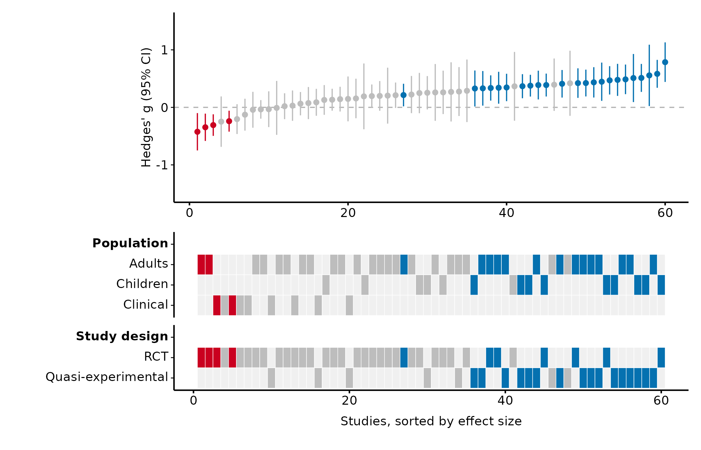

## Effect size scale

### Ratios: `null_value`

Colours depend on whether each confidence interval excludes the value
meaning “no effect”. That’s 0 for differences (and log ratios) and 1 for
ratios such as odds ratios. Odds-ratio intervals aren’t symmetric, so
give the bounds with `lb` and `ub` rather than a variance. Here the
example effects are converted to odds ratios:

``` r

odds <- forestmap_example
to_log_or <- pi / sqrt(3)
odds$or <- exp(odds$smd * to_log_or)
odds$or_lower <- exp((odds$smd - 1.96 * sqrt(odds$vi)) * to_log_or)
odds$or_upper <- exp((odds$smd + 1.96 * sqrt(odds$vi)) * to_log_or)

plot_forestmap(
  odds, "or", "or_lower", "or_upper",
  moderators = c("Population" = "population", "Study design" = "design"),
  null_value = 1,
  y_label = "Odds ratio (95% CI)"
)
```

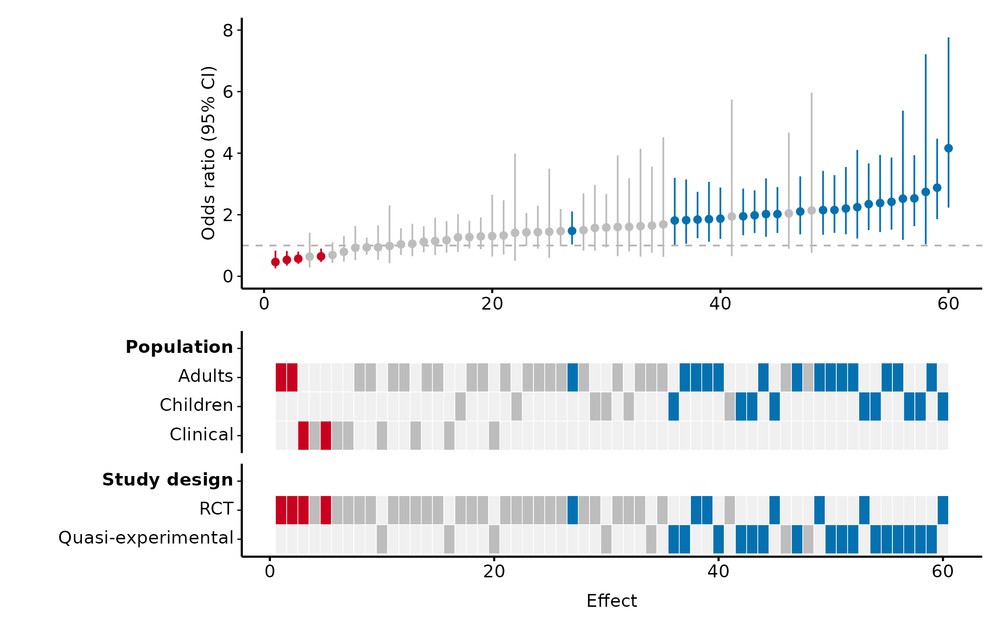

Ratios are often easier to read on the log scale: plot `log(or)` with
its variance (`vi`) and the default `null_value = 0`.

### Effects too small to matter: `rope`

`rope` shades a band of effects you consider too small to matter (a
“region of practical equivalence”). Give two numbers, or one number for
a band symmetric around `null_value`:

``` r

plot_forestmap(
  forestmap_example, "smd", vi = "vi",
  moderators = c("Population" = "population", "Study design" = "design"),
  rope = c(-0.1, 0.1)
)
```

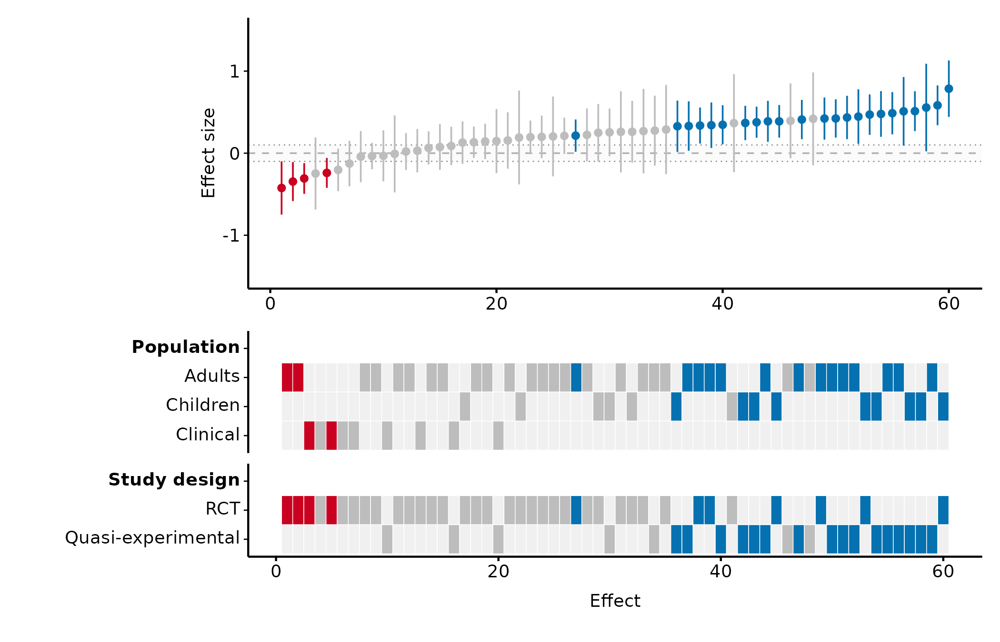

### Axis range: `y_limits`

By default the y-axis is symmetric around `null_value` and wide enough
to show every confidence interval (for ratios, it starts at 0). Set your
own range with `y_limits`; parts of intervals outside it are cut off:

``` r

plot_forestmap(
  forestmap_example, "smd", vi = "vi",
  moderators = c("Population" = "population", "Study design" = "design"),
  y_limits = c(-1, 1.2)
)
```

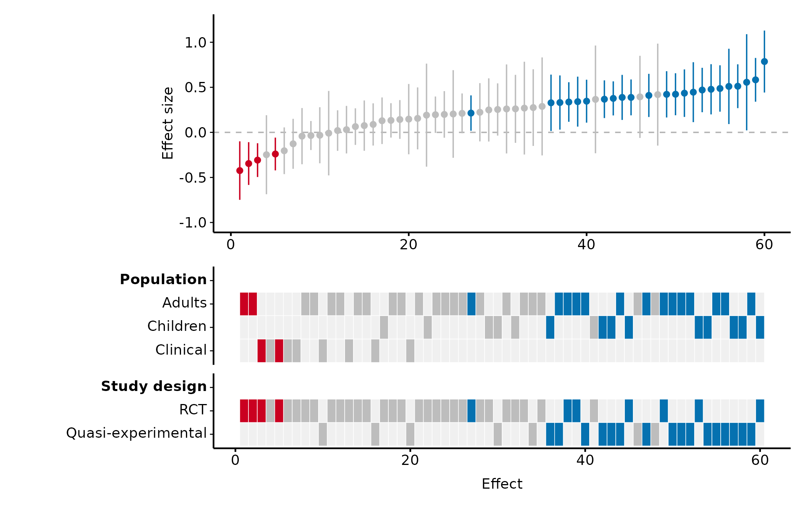

## Colours

### Built-in palettes

Choose a palette by name. The options are `"default"` (shown in the
examples above), `"okabe_ito"`, `"viridis"` and `"greyscale"`.

`"okabe_ito"` uses blue and vermillion from the Okabe–Ito palette,
designed to stay distinguishable for people with common types of colour
blindness:

``` r

plot_forestmap(
  forestmap_example, "smd", vi = "vi",
  moderators = c("Population" = "population", "Study design" = "design"),
  palette = "okabe_ito"
)
```

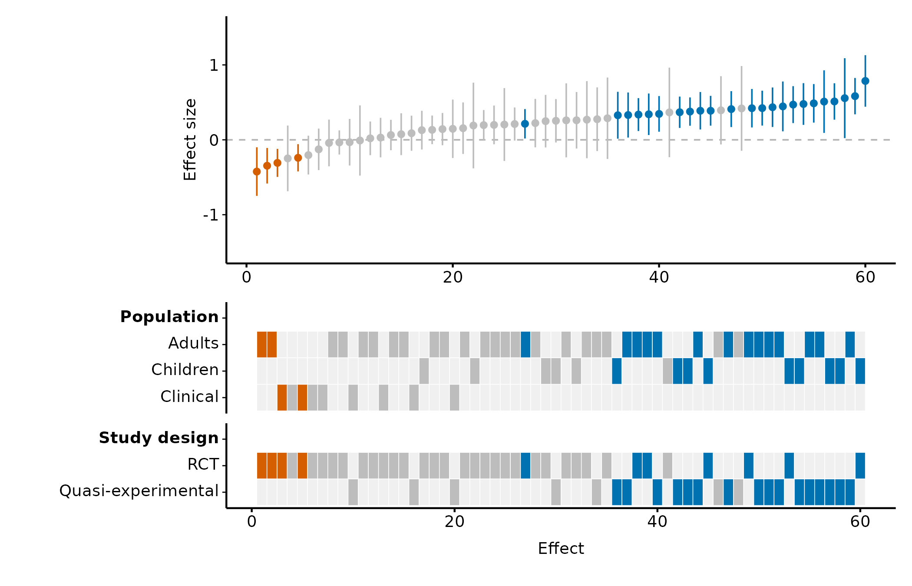

`"viridis"`:

``` r

plot_forestmap(
  forestmap_example, "smd", vi = "vi",
  moderators = c("Population" = "population", "Study design" = "design"),
  palette = "viridis"
)
```

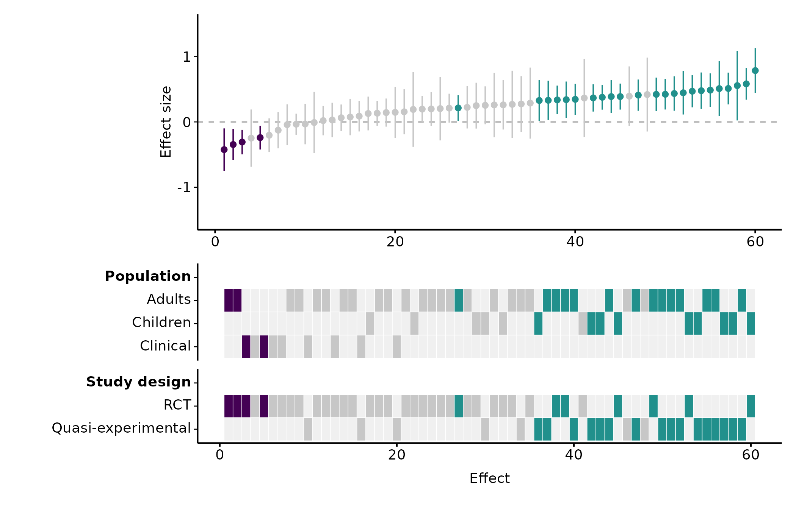

`"greyscale"`, for black-and-white printing:

``` r

plot_forestmap(
  forestmap_example, "smd", vi = "vi",
  moderators = c("Population" = "population", "Study design" = "design"),
  palette = "greyscale"
)
```

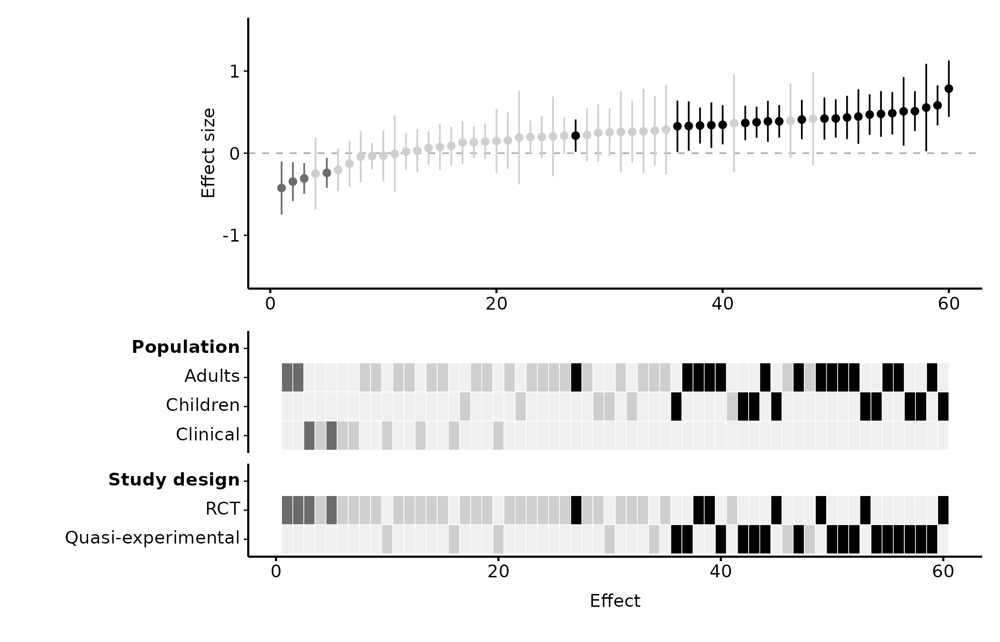

### Your own colours

Give three colours: for positive effects, negative effects, and effects
whose interval includes the null value. Any colour name or hex code
works:

``` r

plot_forestmap(
  forestmap_example, "smd", vi = "vi",
  moderators = c("Population" = "population", "Study design" = "design"),
  palette = c(positive = "#1b7837", negative = "#762a83", null = "grey75")
)
```

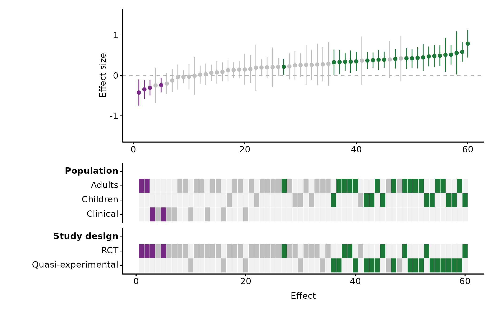

## Font and text size

### Font

`font` takes the name of any font installed on your computer. The
default is `"Arial Narrow"` (or a plain sans-serif font if it isn’t
installed). The generic names `"sans"`, `"serif"` and `"mono"` work
everywhere:

``` r

plot_forestmap(
  forestmap_example, "smd", vi = "vi",
  moderators = c("Population" = "population", "Study design" = "design"),
  font = "serif"
)
```

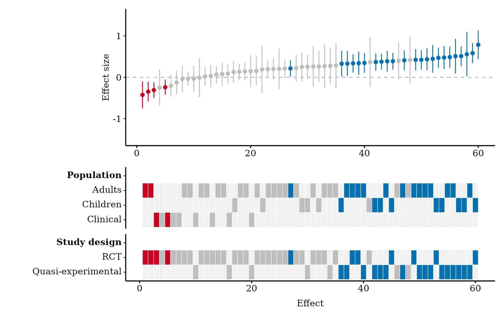

To see which fonts you have, run `systemfonts::system_fonts()$family`.
You can also use a font file that isn’t installed, by giving its path:

``` r

plot_forestmap(
  forestmap_example, "smd", vi = "vi",
  moderators = c("Population" = "population", "Study design" = "design"),
  font = "fonts/MyFont-Regular.ttf"
)
```

### Text size

`text_size` sets the size of all text, in points (default 9):

``` r

plot_forestmap(
  forestmap_example, "smd", vi = "vi",
  moderators = c("Population" = "population", "Study design" = "design"),
  text_size = 12
)
```

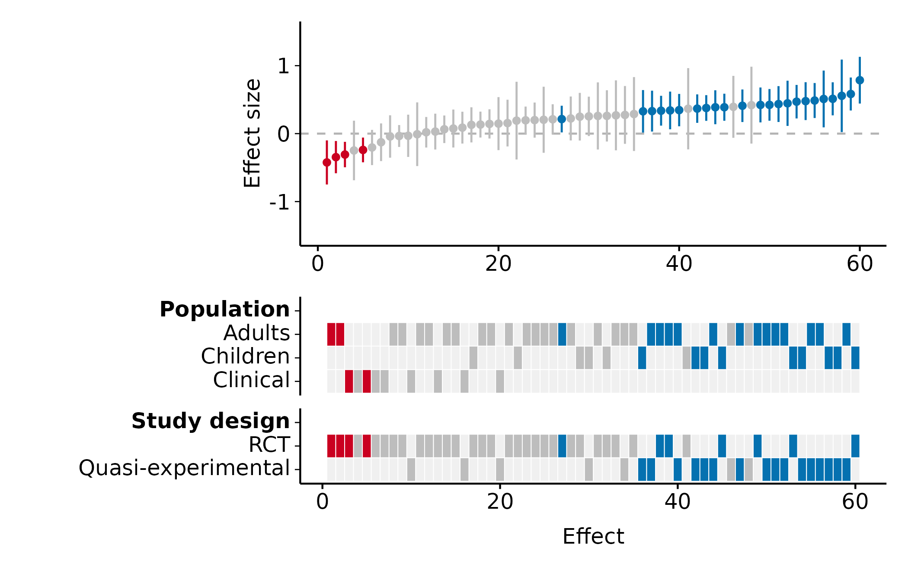

## Panel heights

By default, the heatmap gets more of the plot’s height the more rows it
has. `forest_height` sets the forest plot’s share of the height
yourself, between 0 and 1. Here the forest plot and heatmap get half
each:

``` r

plot_forestmap(
  forestmap_example, "smd", vi = "vi",
  moderators = c("Population" = "population", "Study design" = "design"),
  forest_height = 0.5
)
```

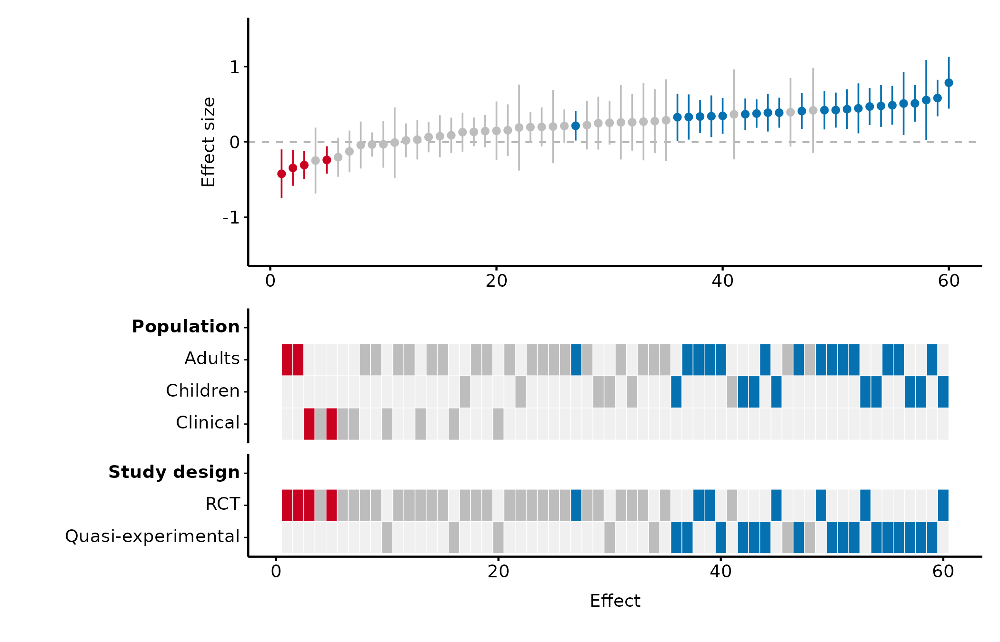

## Many study properties

With many properties or levels the heatmap gets tall. Two options help.

### Compact layout

`layout = "compact"` puts each property’s name beside its rows instead
of on a row of its own:

``` r

plot_forestmap(
  forestmap_example, "smd", vi = "vi",
  moderators = c(
    "Population" = "population",
    "Outcome measure" = "outcome",
    "Study design" = "design",
    "Country" = "country"
  ),
  layout = "compact"
)
```

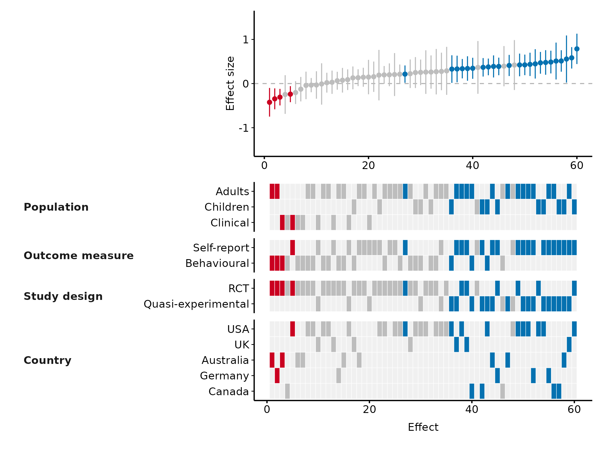

### Fewer rows: `max_levels`

`max_levels` sets the most rows any property can have. The most common
levels are kept, and the rest are merged into one “Other” row. With
`max_levels = 3`, the five countries become USA, Australia and Other:

``` r

plot_forestmap(
  forestmap_example, "smd", vi = "vi",
  moderators = c(
    "Population" = "population",
    "Outcome measure" = "outcome",
    "Study design" = "design",
    "Country" = "country"
  ),
  layout = "compact",
  max_levels = 3
)
```

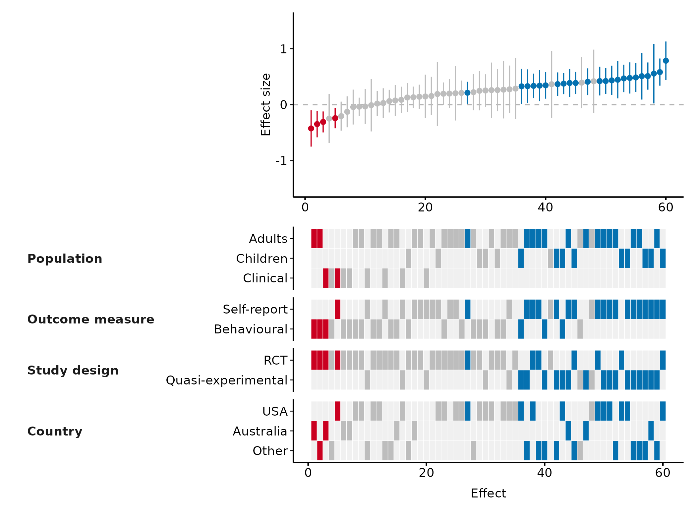

If several levels tie for the last place, all of them are kept and you
get a warning saying so.

## Going further with ggplot2 and patchwork

[`plot_forestmap()`](https://shaheedazaad.github.io/forestmap/reference/plot_forestmap.md)
returns a [patchwork](https://patchwork.data-imaging.com) of two ggplot2
plots: `p[[1]]` is the forest plot and `p[[2]]` the heatmap. You can add
to either one.

### Title and caption

``` r

p <- plot_forestmap(
  forestmap_example, "smd", vi = "vi",
  moderators = c("Population" = "population", "Study design" = "design")
)

p + patchwork::plot_annotation(
  title = "Effects of the intervention",
  subtitle = "60 studies, sorted by effect size",
  caption = "Simulated data"
)
```

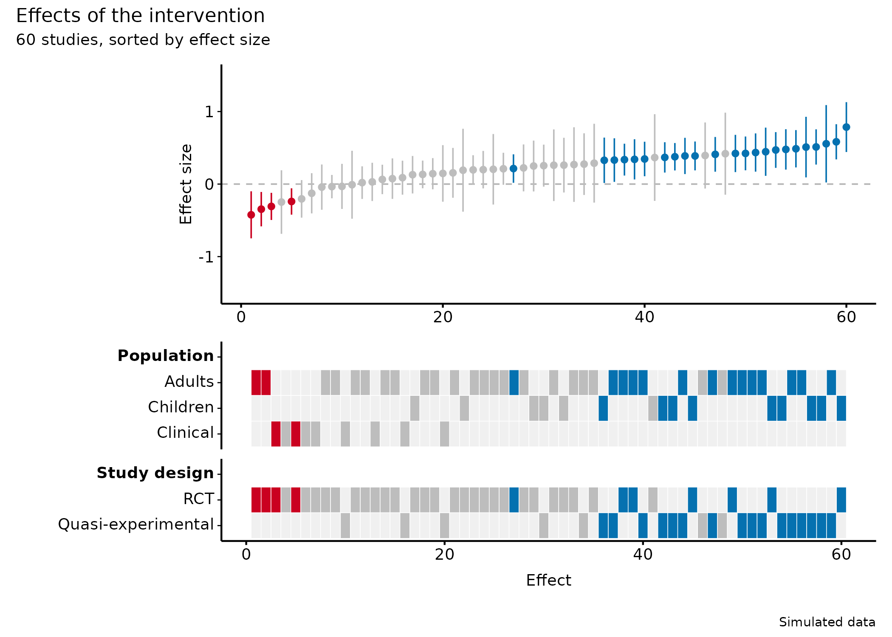

### Show the pooled effect

Add a line to the forest plot, for example at the pooled effect from
your meta-analysis. Here it’s a simple inverse-variance (fixed-effect)
average:

``` r

pooled <- weighted.mean(forestmap_example$smd, w = 1 / forestmap_example$vi)

p <- plot_forestmap(
  forestmap_example, "smd", vi = "vi",
  moderators = c("Population" = "population", "Study design" = "design")
)

p[[1]] <- p[[1]] +
  ggplot2::geom_hline(yintercept = pooled, colour = "black", linewidth = 0.4) +
  ggplot2::annotate(
    "text", x = 1, y = pooled, label = "Pooled effect",
    hjust = 0, vjust = -0.6, size = 3, family = "sans"
  )
p
```

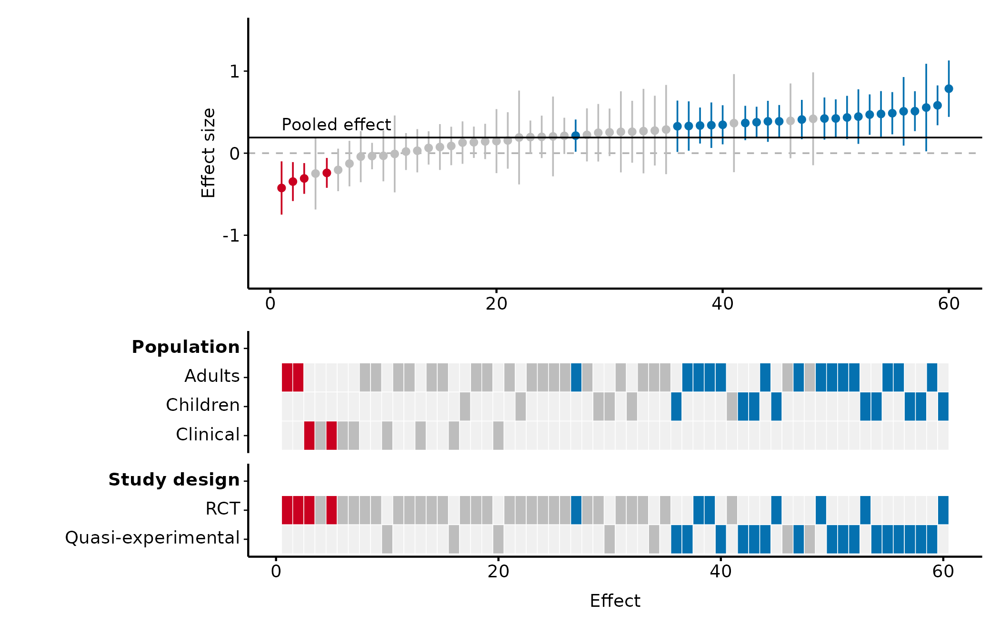

Text added with `annotate()` doesn’t pick up the plot’s font
automatically, so set `family` to the same font you gave
[`plot_forestmap()`](https://shaheedazaad.github.io/forestmap/reference/plot_forestmap.md).

### Axis breaks

Change where the y-axis labels go with `scale_y_continuous()`. Use round
numbers; [`seq()`](https://rdrr.io/r/base/seq.html) can create tiny
rounding errors that show up as odd labels:

``` r

p <- plot_forestmap(
  forestmap_example, "smd", vi = "vi",
  moderators = c("Population" = "population", "Study design" = "design")
)

p[[1]] <- p[[1]] + ggplot2::scale_y_continuous(breaks = c(-1, -0.5, 0, 0.5, 1))
p
```


## Saving

[`plot_forestmap()`](https://shaheedazaad.github.io/forestmap/reference/plot_forestmap.md)
doesn’t save anything; use
[`ggplot2::ggsave()`](https://ggplot2.tidyverse.org/reference/ggsave.html)
and choose the size there. The plot looks best at around 7 × 5 inches
with four properties; add height as you add rows.

``` r

ggplot2::ggsave("forestmap.png", p, width = 7, height = 5.25, dpi = 300)
ggplot2::ggsave("forestmap.svg", p, width = 7, height = 5.25)
ggplot2::ggsave("forestmap.pdf", p, width = 7, height = 5.25, device = cairo_pdf)
```

For PDFs, `device = cairo_pdf` makes sure fonts such as Arial Narrow
work.
