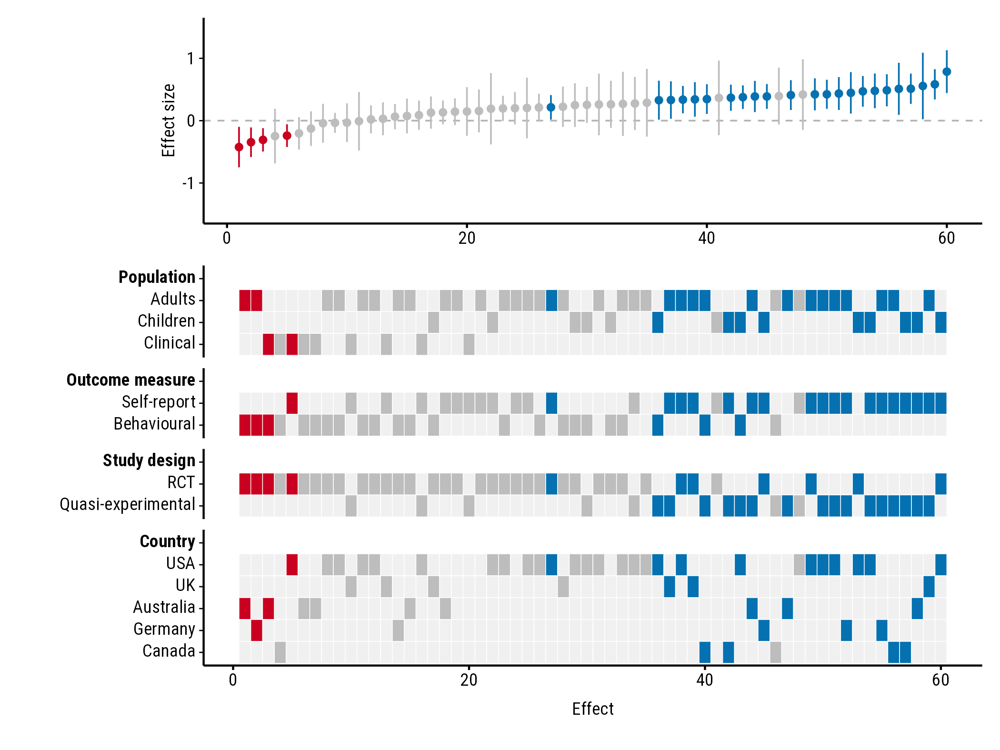

# Getting started with forestmap

``` r

library(forestmap)
```

## What forestmap draws

A forest plot shows each study in a meta-analysis with its effect size
and confidence interval. forestmap sorts the studies from the smallest
to the largest effect and adds a heatmap underneath showing each study’s
properties: its population, design, country, or anything else you’ve
coded. Reading down a column tells you about one study; reading across a
row tells you where studies with that property fall among the effects.

## 1. Prepare your data

You need a data frame with **one row per study** and these columns:

| Column | What it holds |
|----|----|
| Effect size | The study’s effect, e.g. a standardised mean difference. |
| Sampling variance | The variance of that effect, e.g. `vi` from `metafor::escalc()`. |
| One column per study property | A factor giving the study’s level, e.g. `"RCT"`, or a number, e.g. mean age. `NA` means the study doesn’t report it. |

The package comes with made-up data from 60 studies:

``` r

head(forestmap_example)
#>         study   smd      vi   n population     outcome             design
#> 1   Wang 2005 0.470 0.01581 253   Children        <NA>                RCT
#> 2 Hughes 2013 0.261 0.03704 108   Children Behavioural                RCT
#> 3  Rossi 2005 0.510 0.04545  88     Adults Self-report Quasi-experimental
#> 4  Baker 2006 0.410 0.01493 268     Adults        <NA> Quasi-experimental
#> 5 Hughes 2008 0.786 0.03077 130   Children Self-report                RCT
#> 6 Martin 2023 0.260 0.06349  63     Adults        <NA>                RCT
#>     country
#> 1       USA
#> 2      <NA>
#> 3    Canada
#> 4 Australia
#> 5       USA
#> 6       USA
```

The order of a factor’s levels sets the order of the rows in the
heatmap, so use `factor(x, levels = ...)` to change it.

If you’ve computed effect sizes with
[metafor](https://www.metafor-project.org)’s `escalc()`, your data
already has the effect (`yi`) and sampling variance (`vi`): pass them as
`es = "yi", vi = "vi"`.

Instead of variances you can give **standard errors** (`se = "..."`), or
the **lower and upper bounds** of each 95% confidence interval
(`lb = "...", ub = "..."`). Use the bounds when the interval isn’t
symmetric, such as odds ratios on their original scale. From variances
or standard errors, the interval is the effect ± 1.96 standard errors.

## 2. Make the plot

Tell
[`plot_forestmap()`](https://shaheedazaad.github.io/forestmap/reference/plot_forestmap.md)
which column is which. Naming the study properties sets the headings in
the plot:

``` r

plot_forestmap(
  forestmap_example,
  es = "smd",
  vi = "vi",
  moderators = c(
    "Population" = "population",
    "Outcome measure" = "outcome",
    "Study design" = "design",
    "Country" = "country"
  )
)
```



## 3. Read the plot

- Each column is one study. The top panel shows its effect and 95%
  confidence interval; the tiles below show its properties.
- **Blue** studies have a confidence interval entirely above zero,
  **red** ones entirely below, and **grey** ones include zero. Each
  study’s tiles take the same colour.
- A row with its tiles bunched at one end means studies with that
  property tend to find smaller (left) or larger (right) effects. Here,
  every negative effect comes from an RCT, and the largest effects come
  mostly from quasi-experimental studies using self-report measures.

## 4. Save it

[`plot_forestmap()`](https://shaheedazaad.github.io/forestmap/reference/plot_forestmap.md)
returns the plot; saving it is up to you. Choose the size when you save:

``` r

p <- plot_forestmap(
  forestmap_example, "smd", vi = "vi",
  moderators = c("Population" = "population", "Study design" = "design")
)

ggplot2::ggsave("forestmap.png", p, width = 7, height = 5.25, dpi = 300)
ggplot2::ggsave("forestmap.svg", p, width = 7, height = 5.25)
ggplot2::ggsave("forestmap.pdf", p, width = 7, height = 5.25, device = cairo_pdf)
```

With many study properties, make the plot taller (e.g. `height = 10`).

The default font, Roboto Condensed, comes with forestmap, and PNG and
SVG files saved with `ggsave()` always use it. Two places only see fonts
installed on your computer, and show another font until you install
Roboto Condensed (the font files are in the folder given by
`system.file("fonts", package = "forestmap")`):

- **RStudio’s Plots pane.** Alternatively, set *Tools \> Global Options
  \> General \> Graphics \> Backend* to **AGG**.
- **PDF files**, saved with `device = cairo_pdf` as above.

## Next steps

The guides show every option, with an example of each:

- [Study
  properties](https://shaheedazaad.github.io/forestmap/articles/study-properties.html):
  headings, order, and shortening a tall heatmap.
- [Numeric study
  properties](https://shaheedazaad.github.io/forestmap/articles/numeric-properties.html):
  properties such as mean age or sample size.
- [Effect sizes and
  axes](https://shaheedazaad.github.io/forestmap/articles/axes.html):
  ratios, a band of negligible effects, and axis ranges.
- [Colours, fonts and
  size](https://shaheedazaad.github.io/forestmap/articles/appearance.html):
  palettes, fonts, text size and panel heights.
- [Adding to the plot and
  saving](https://shaheedazaad.github.io/forestmap/articles/extending.html):
  titles, a pooled-effect line, and saving to a file.
