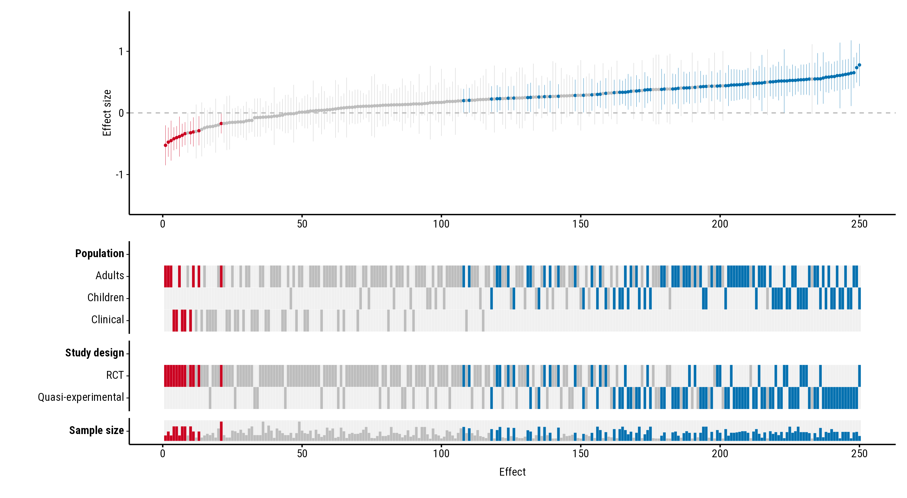
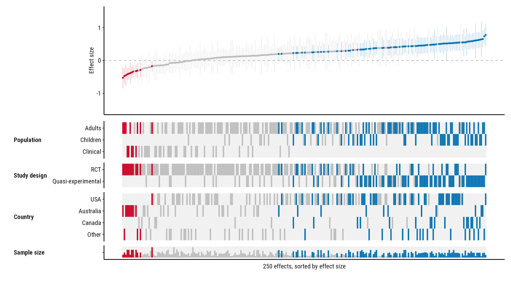

# Large meta-analyses

``` r

library(forestmap)
```

A forestmap works the same with hundreds of effects as with a few dozen.
This page shows how a plot of 250 effects looks, and which settings help
it stay readable.

## 250 effects

The `forestmap_example` data has 60 studies. For a larger example, draw
250 effects from it at random and add a little noise, so no two are the
same:

``` r

set.seed(1)
big <- forestmap_example[sample(nrow(forestmap_example), 250, replace = TRUE), ]
big$smd <- big$smd + rnorm(nrow(big), 0, 0.1)
```

Plot it as usual:

``` r

plot_forestmap(
  big, "smd", vi = "vi",
  moderators = c(
    "Population" = "population",
    "Study design" = "design",
    "Sample size" = "n"
  )
)
```



Each effect is a column, about 0.4% of the plot’s width. With more than
60 effects, the points, interval lines and white borders between heatmap
tiles get thinner, so neighbouring effects don’t merge into a block. The
plot then reads as a pattern rather than as single studies: the colour
bands show where in the ranking studies with each property fall, and the
sample-size row shows whether larger studies find smaller effects.

## Settings that help

The rank numbers along the study axis say little with 250 effects, so
`study_ticks = FALSE` removes them. The compact layout, with property
names to the left of their rows, makes the heatmap shorter and leaves
more room for the forest plot. `max_levels` merges rare levels into
“Other”, so each property has fewer, fuller rows:

``` r

plot_forestmap(
  big, "smd", vi = "vi",
  moderators = c(
    "Population" = "population",
    "Study design" = "design",
    "Country" = "country",
    "Sample size" = "n"
  ),
  layout = "compact",
  max_levels = 4,
  study_ticks = FALSE,
  x_label = "250 effects, sorted by effect size"
)
```



Give the plot plenty of width when you save it. As a rough guide, allow
about 0.04 inches per effect, and at least 8 inches:

``` r

p <- plot_forestmap(big, "smd", vi = "vi", moderators = c("Population" = "population"))
ggplot2::ggsave("forestmap.png", p, width = 12, height = 6, dpi = 300)
```

## The alternative: a vertical layout

When you want to name each study, or the plot is going on a portrait
page, turn it on its side with `orientation = "vertical"`. Each effect
is then a row, and the plot grows downwards instead of across. See the
[vertical
layout](https://shaheedazaad.github.io/forestmap/articles/vertical.md)
guide.
