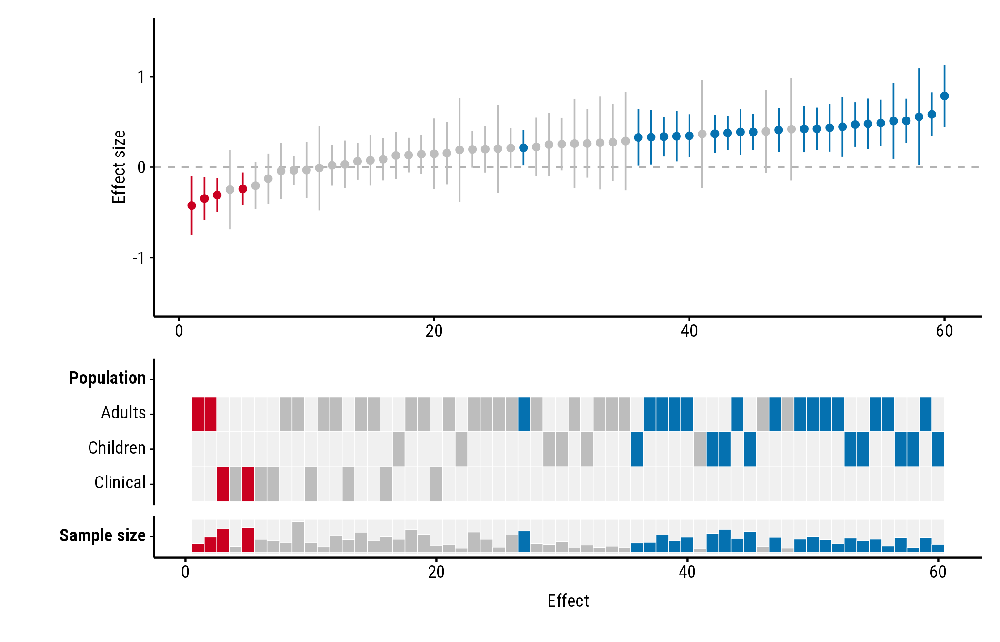
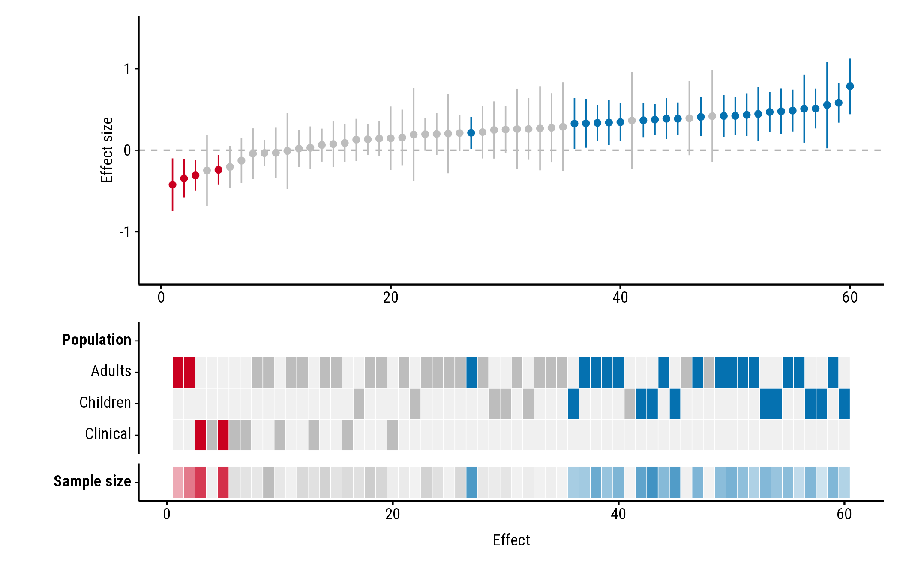
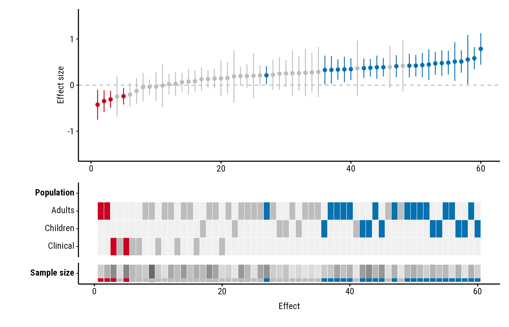
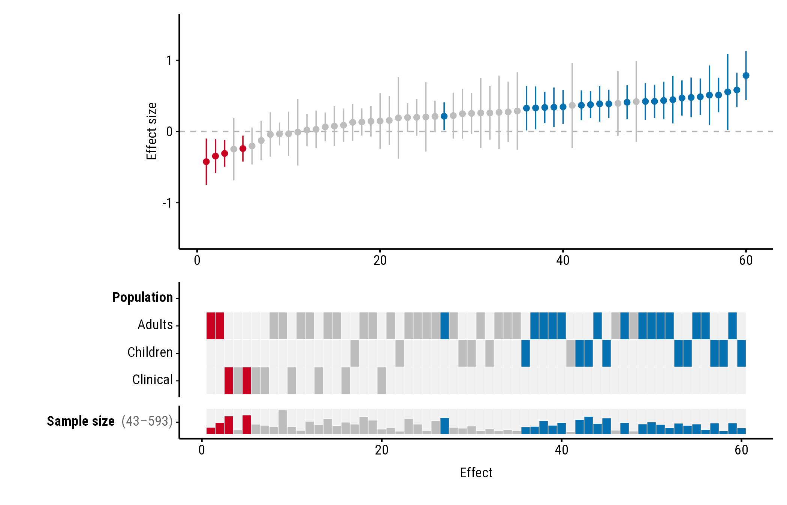
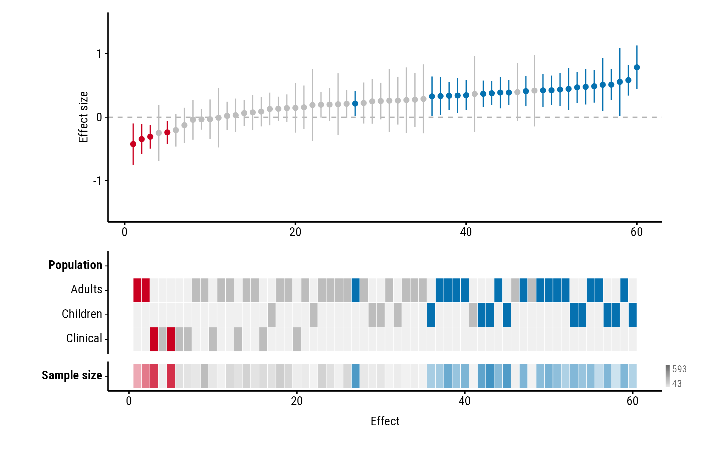
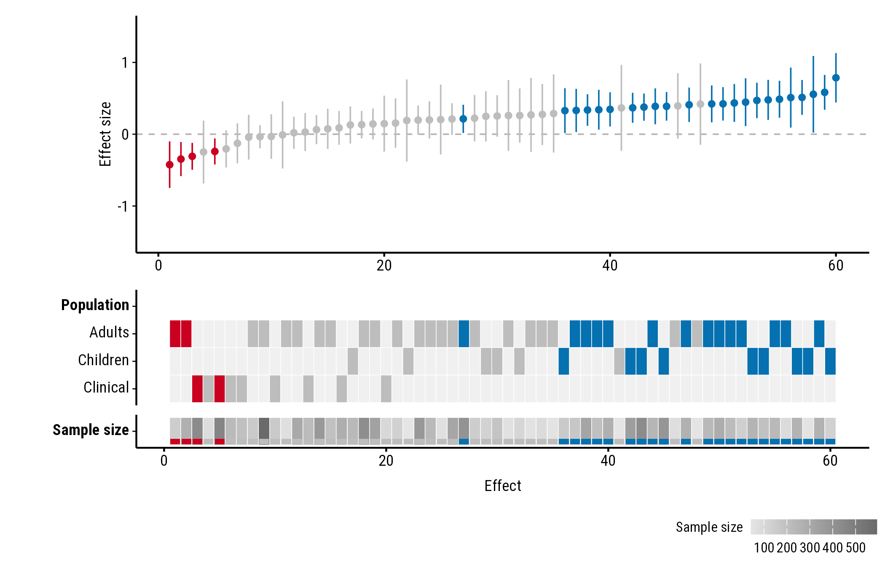
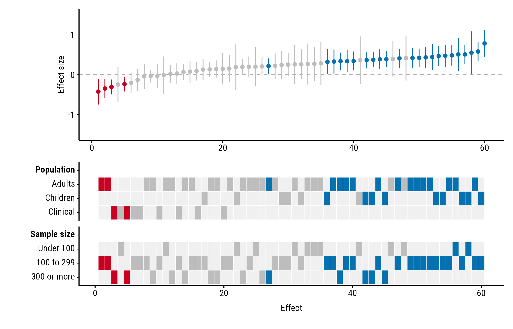
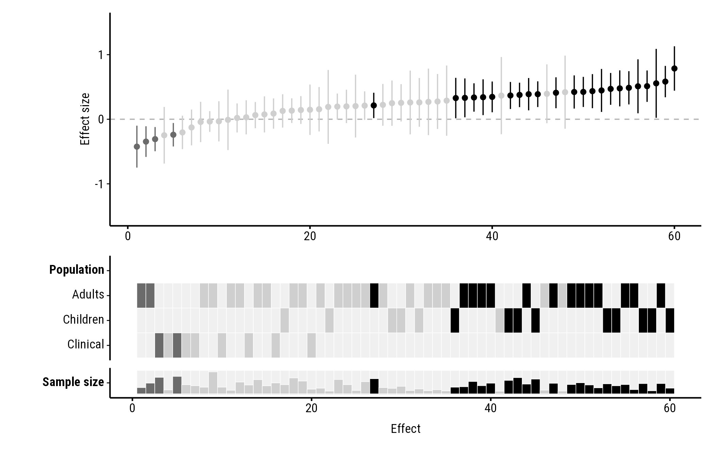

# Numeric study properties

``` r

library(forestmap)
```

Study properties don’t have to be categories. A numeric column, such as
mean age or sample size, is shown as a single row of the heatmap. All
the examples use the `forestmap_example` data that comes with the
package; its `n` column holds each study’s sample size.

Each study’s tile shows its value, scaled from the lowest value in the
data to the highest. A study with a missing value (`NA`) gets an empty
tile.

## Styles

`continuous_style` sets how the value is drawn. Every style keeps the
study’s colour (blue, red or grey), so you can still see which studies
found an effect.

### Bar

`"bar"`, the default, draws a bar in the study’s colour, taller for
larger values. Bars start a little above zero height, so even the
smallest value shows its colour:

``` r

plot_forestmap(
  forestmap_example, "smd", vi = "vi",
  moderators = c("Population" = "population", "Sample size" = "n")
)
```



### Tint

`"tint"` fades each tile from a pale version of the study’s colour (the
smallest values) to the full colour (the largest):

``` r

plot_forestmap(
  forestmap_example, "smd", vi = "vi",
  moderators = c("Population" = "population", "Sample size" = "n"),
  continuous_style = "tint"
)
```



### Stripe

`"stripe"` shows the value as a shade of grey, the same for every study,
with a band in the study’s colour along the bottom of the tile:

``` r

plot_forestmap(
  forestmap_example, "smd", vi = "vi",
  moderators = c("Population" = "population", "Sample size" = "n"),
  continuous_style = "stripe"
)
```



## Showing the range

By default the plot doesn’t say which values the shades or bars stand
for. `continuous_range` adds the lowest and highest value, in one of
three places. Each works with every style.

### In the label

`"label"` adds the range after the property’s name:

``` r

plot_forestmap(
  forestmap_example, "smd", vi = "vi",
  moderators = c("Population" = "population", "Sample size" = "n"),
  continuous_range = "label"
)
```



### At the end of the row

`"end"` puts a small key at the right end of the row, with the highest
value at the top and the lowest at the bottom:

``` r

plot_forestmap(
  forestmap_example, "smd", vi = "vi",
  moderators = c("Population" = "population", "Sample size" = "n"),
  continuous_style = "tint",
  continuous_range = "end"
)
```



### In a legend

`"legend"` adds a legend below the plot, one for each numeric property:

``` r

plot_forestmap(
  forestmap_example, "smd", vi = "vi",
  moderators = c("Population" = "population", "Sample size" = "n"),
  continuous_style = "stripe",
  continuous_range = "legend"
)
```



## Numbers as categories

To show a numeric column as categories instead, convert it to a factor
first. [`factor()`](https://rdrr.io/r/base/factor.html) gives one row
per value, which suits numbers that stand for groups, such as a site
number. [`cut()`](https://rdrr.io/r/base/cut.html) groups a range of
values:

``` r

dat <- forestmap_example
dat$size <- cut(
  dat$n,
  breaks = c(0, 100, 300, Inf),
  labels = c("Under 100", "100 to 299", "300 or more"),
  right = FALSE
)

plot_forestmap(
  dat, "smd", vi = "vi",
  moderators = c("Population" = "population", "Sample size" = "size")
)
```



## Colours

Bar and tint use the plot’s palette, so they change with it. Stripe’s
grey is matched to how dark the palette is. With the `"greyscale"`
palette every colour is a grey, which makes tint and stripe hard to
read, so keep the default bars:

``` r

plot_forestmap(
  forestmap_example, "smd", vi = "vi",
  moderators = c("Population" = "population", "Sample size" = "n"),
  palette = "greyscale"
)
```


