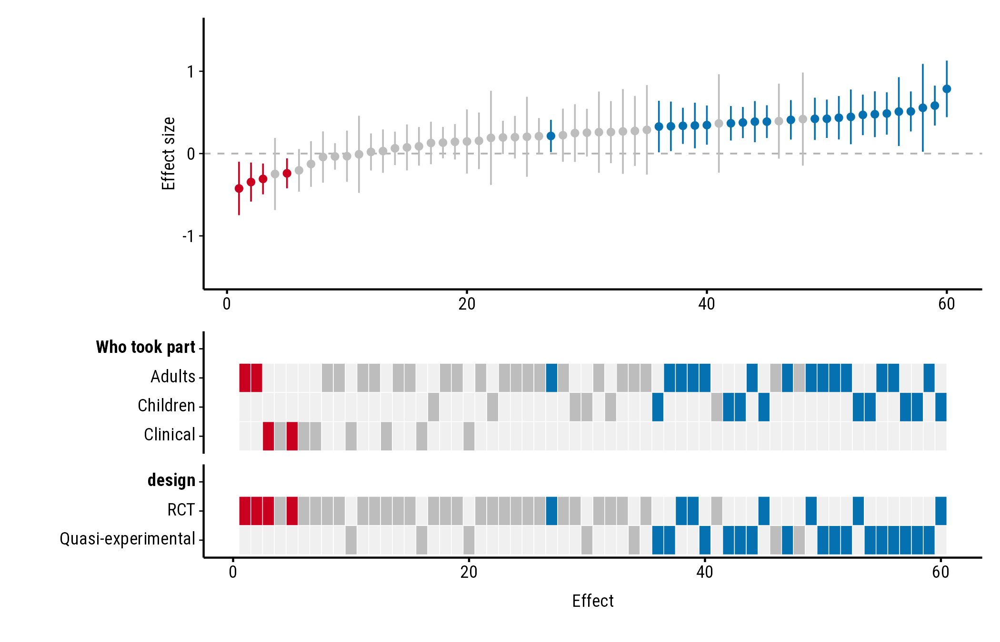
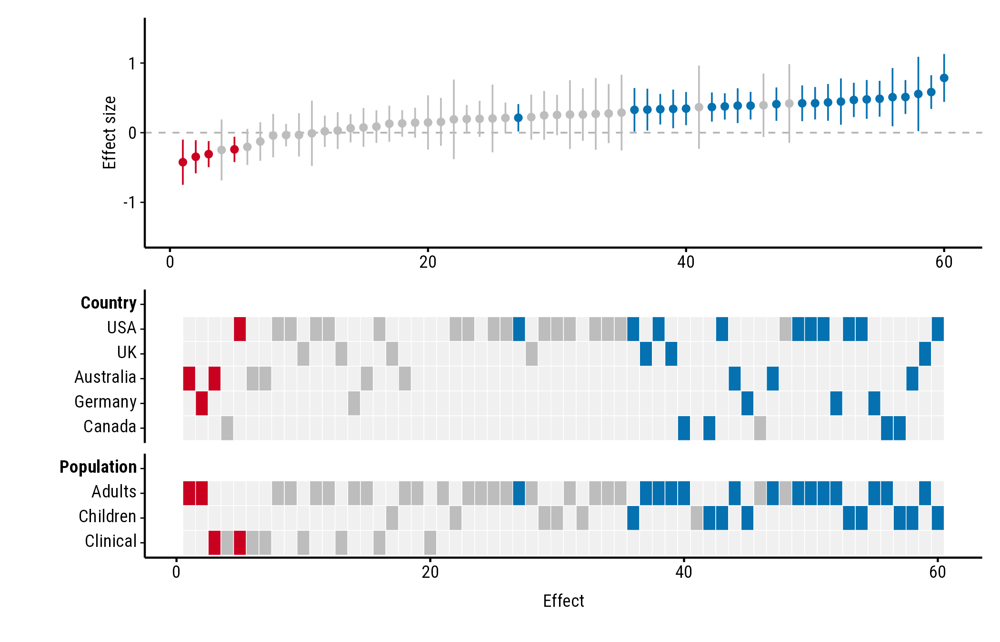
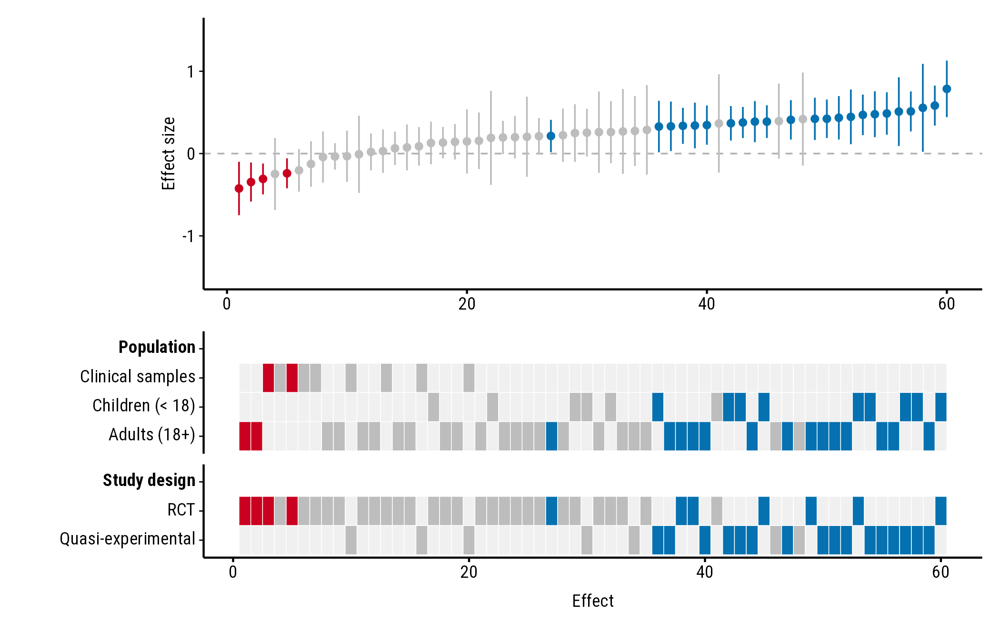
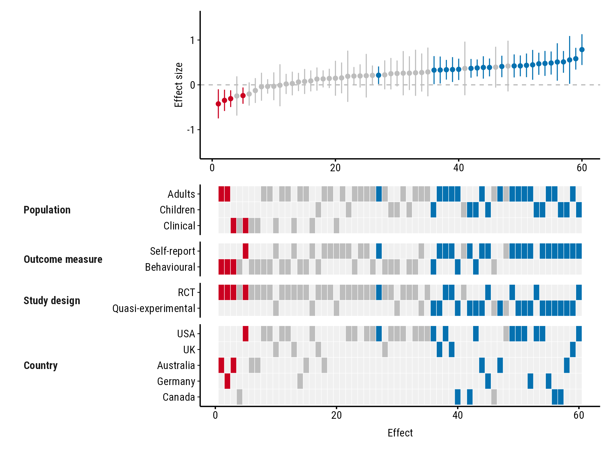
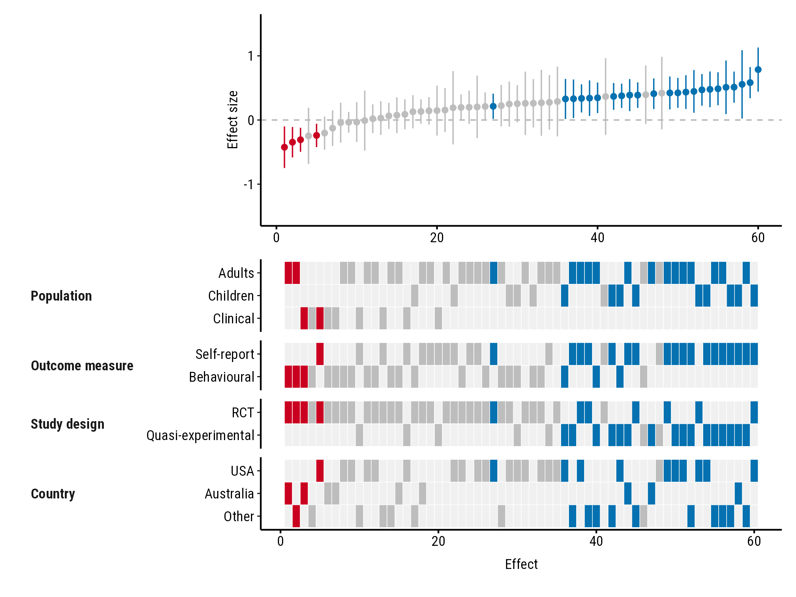

# Study properties

``` r

library(forestmap)
```

How to choose which study properties the heatmap shows, in what order,
and how to shorten the heatmap when there are many. All the examples use
the `forestmap_example` data that comes with the package.

## Headings

Name each property to set its heading. Without a name, the column name
is used:

``` r

plot_forestmap(
  forestmap_example, "smd", vi = "vi",
  moderators = c("Who took part" = "population", "design")
)
```



## Which properties, in which order

The heatmap shows the properties you list, in the order you list them:

``` r

plot_forestmap(
  forestmap_example, "smd", vi = "vi",
  moderators = c("Country" = "country", "Population" = "population")
)
```



## Order and names of the rows

Rows follow the order of the factor’s levels. Change the order with
`factor(..., levels = ...)`, and rename levels with `labels = ...`:

``` r

dat <- forestmap_example
dat$population <- factor(
  dat$population,
  levels = c("Clinical", "Children", "Adults"),
  labels = c("Clinical samples", "Children (< 18)", "Adults (18+)")
)

plot_forestmap(
  dat, "smd", vi = "vi",
  moderators = c("Population" = "population", "Study design" = "design")
)
```



## Numeric properties

A numeric column, such as mean age or sample size, gets a single row
instead of one row per level. See [Numeric study
properties](https://shaheedazaad.github.io/forestmap/articles/numeric-properties.md).

## Shortening a tall heatmap

With many properties or levels the heatmap gets tall. Two options help.

### Compact layout

`layout = "compact"` puts each property’s name beside its rows instead
of on a row of its own:

``` r

plot_forestmap(
  forestmap_example, "smd", vi = "vi",
  moderators = c(
    "Population" = "population",
    "Outcome measure" = "outcome",
    "Study design" = "design",
    "Country" = "country"
  ),
  layout = "compact"
)
```



### Fewer rows: `max_levels`

`max_levels` sets the most rows any property can have. The most common
levels are kept, and the rest are merged into one “Other” row. With
`max_levels = 3`, the five countries become USA, Australia and Other:

``` r

plot_forestmap(
  forestmap_example, "smd", vi = "vi",
  moderators = c(
    "Population" = "population",
    "Outcome measure" = "outcome",
    "Study design" = "design",
    "Country" = "country"
  ),
  layout = "compact",
  max_levels = 3
)
```



If several levels tie for the last place, all of them are kept and you
get a warning saying so.
